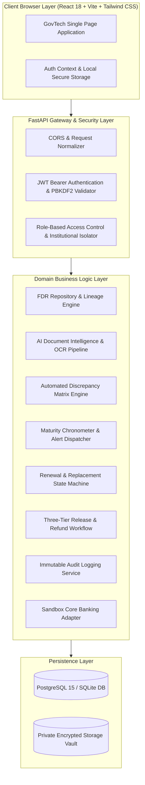

# DEPOSIT360: System Architecture & Data Flow

## 1. Modular Monolithic Architecture
DEPOSIT360 follows an enterprise GovTech modular monolithic architecture designed for maximum reliability, transactional integrity, operational simplicity, and deployment ease.

## 2. Key Subsystems
1. **Multi-Tenant Institutional Isolation:**
   - Every request is validated against the authenticated user's `institution_id`. Institution Admins are strictly scoped to their own records.
2. **AI Document Intelligence Engine:**
   - Dual-engine: Native PDF textual extraction using PyMuPDF (fitz) combined with Tesseract OCR fallback for scanned certificates.
   - Computes completeness score, confidence intervals, and runs discrepancy matrix against submitted metadata.
3. **Maturity Chronometer:**
   - Calculates exact remaining days to maturity ($Maturity - Today$).
   - Alerts at 90d, 60d, 30d, 7d, 0d, and overdue.
4. **Three-Tier Release Governance:**
   - Tier 1: Institution application with compliance justification.
   - Tier 2: Scrutiny Officer examination and formal recommendation.
   - Tier 3: Competent Authority digital approval with mandatory reasoning.
