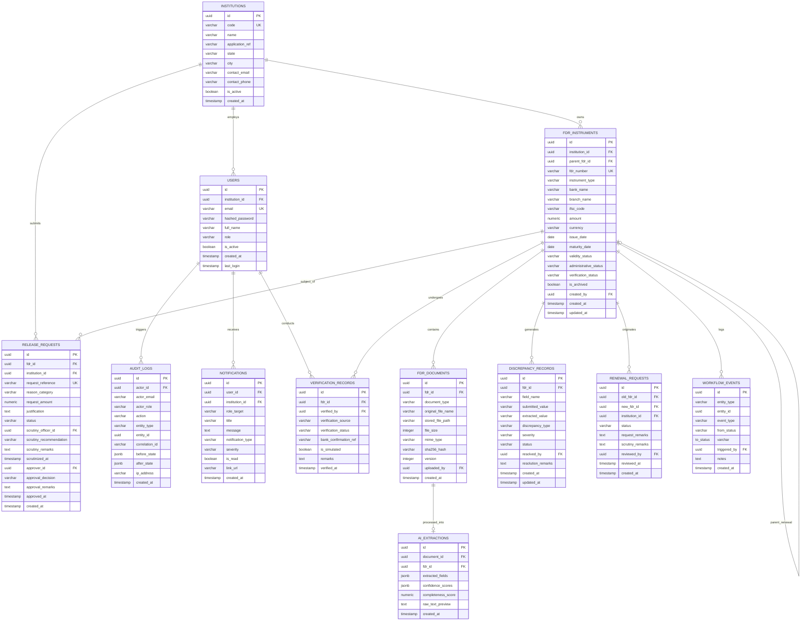
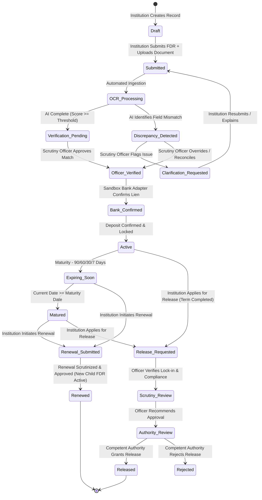
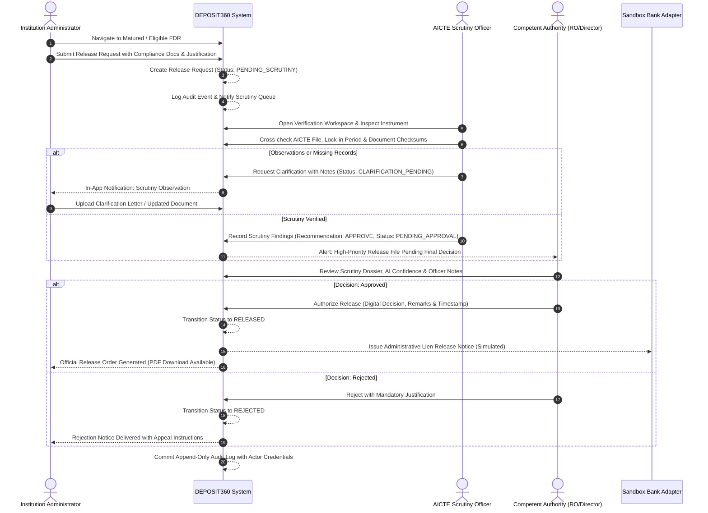

# DEPOSIT360: AICTE Security Deposit & FDR Management Platform
## System Architecture & Specification (Phase 1 Deliverable)

### 1. Executive Summary & Problem Context
AICTE mandates technical educational institutions to submit Security Deposits in the form of Fixed Deposit Receipts (FDRs) jointly encashed/pledged in the name of the Regional Officer, AICTE, and the respective institution trust/society. These FDRs safeguard compliance, faculty salaries, student fee protection, and institutional stability over lock-in periods of 8 to 10 years.

Presently, this lifecycle is plagued by:
- Fragmented, paper-based FDR submissions across regional offices.
- Undetected maturity dates leading to dormant funds or premature liquidation without AICTE lien enforcement.
- Manual data entry errors between bank-issued certificates and portal entries.
- Opaque, slow scrutiny workflows for lien release upon term completion.
- Absence of real-time provenance tracking and centralized analytics.

**DEPOSIT360** transforms this regulatory process into a smart, automated, transparent, and auditable enterprise GovTech platform.

---

### 2. Functional Requirements (FR)
- **FR-01: Identity, RBAC & Institution Multi-Tenancy**: Granular access control for Institution Admins, AICTE Scrutiny Officers, Competent Authorities, and Super Admins. Strict tenant isolation.
- **FR-02: Centralized FDR Instrument Repository**: Full lifecycle tracking of FDRs with issuing bank details, branches, IFSC, amounts, lock-in duration, and parent-child renewal lineage.
- **FR-03: Secure Document Vault**: Upload and storage of FDR scanned copies and compliance certificates with SHA-256 integrity verification, safe internal storage paths, and role-gated streaming.
- **FR-04: AI Document Intelligence Pipeline**: Dual-engine extraction (PyMuPDF native text extraction with Tesseract OCR fallback), field normalization (dates, currency amounts), completeness scoring, and rule-based discrepancy detection.
- **FR-05: Verification Provenance & Sandbox Bank Adapter**: Four-state verification provenance (`Institution Submitted`, `AI Extracted`, `Officer Verified`, `Bank Confirmed`). Clearly isolated sandbox bank verification adapter.
- **FR-06: Automated Maturity Monitoring & Escalation**: Chronological monitoring engine generating alerts at 90, 60, 30, and 7 days prior to maturity, on maturity, and post-maturity overdue escalation.
- **FR-07: Renewal & Replacement Parent-Child Engine**: Seamless tracking of FDR rollovers and bank instrument replacements while preserving immutable historical records.
- **FR-08: Three-Tier Release & Refund Workflow**: Formal release application, scrutiny officer verification with observation recording, and competent authority approval/rejection with mandatory audit justification.
- **FR-09: Notification Center**: In-app notifications with deduplication, priority tags, and role-based routing.
- **FR-10: GovTech Analytics & Dashboard**: Real-time aggregation of deposit volumes, aging maturity schedules, compliance health, discrepancy ratios, and verification turnaround metrics.
- **FR-11: Data Export & Grid Utilities**: Secure CSV/PDF generation with role-based masking and advanced filterable data grids.
- **FR-12: System Configuration & Regulatory Policy Engine**: Dynamic configuration of maturity alert thresholds, discrepancy tolerances, and demo sandbox parameters.

---

### 3. Non-Functional Requirements (NFR)
- **NFR-01: Security**: Argon2 password hashing, short-lived JWT access tokens, CSRF protection, OWASP-compliant input validation, path traversal defense.
- **NFR-02: Data Integrity & Financial Precision**: All monetary values stored as exact arbitrary-precision numeric types (`NUMERIC(15, 2)`). No IEEE 754 floating-point drift.
- **NFR-03: Auditability**: Immutable, append-only audit trail capturing actor, role, action, target entity, timestamp, IP address, and before/after state diffs.
- **NFR-04: Performance**: API response latency < 200ms for p95 transactional queries; client-side cached query invalidation with TanStack Query.
- **NFR-05: Resilience & Fallbacks**: Graceful fallback to manual scrutiny queue when OCR text is degraded; clear error handling without stack trace leakage.
- **NFR-06: GovTech Accessibility & UX**: WCAG 2.1 AA compliant enterprise interface built with Tailwind CSS and Radix UI primitives.
- **NFR-07: Portability**: Multi-environment portability (local student developer environment with Docker Compose or lightweight native Python/Vite runtime).

---

### 4. System Architecture

```mermaid
flowchart TB
    subgraph ClientLayer ["Frontend Presentation Layer (React 18 + TypeScript + Vite)"]
        UI_Inst["Institution Portal\n(FDR Submissions, Renewals, Release Requests)"]
        UI_Off["Scrutiny Officer Workspace\n(Document Scrutiny, Discrepancy Matrix)"]
        UI_Auth["Approving Authority Portal\n(Final Release Decisions, Escalations)"]
        UI_Admin["Super Admin Console\n(System Config, User Management, Audit Logs)"]
        UI_Shared["Shared GovTech UI Component Library\n(Data Grids, Document Viewer, KPI Widgets, Alerts)"]
    end

    subgraph APILayer ["FastAPI Application Gateway & Controller Layer"]
        AuthRouter["/api/v1/auth & /users"]
        FDRRouter["/api/v1/fdrs & /institutions"]
        DocRouter["/api/v1/documents & /ocr"]
        VerifyRouter["/api/v1/verification & /discrepancies"]
        WorkflowRouter["/api/v1/renewals & /releases"]
        AnalyticsRouter["/api/v1/reports & /notifications & /audit"]
    end

    subgraph ServiceLayer ["Domain Services & Business Logic"]
        AuthSvc["Auth & RBAC Service (Argon2 / JWT)"]
        FDRSvc["FDR Lifecycle & Repository Service"]
        DocSvc["Document Vault & Checksum Service"]
        AIEngine["AI Extraction & Discrepancy Engine\n(PyMuPDF / Tesseract / Rule Matcher)"]
        MaturityEngine["Maturity Chrono-Monitor & Alert Escalator"]
        WorkflowEngine["Renewal & Release Approval State Machine"]
        AuditSvc["Immutable Audit Logging Service"]
        BankAdapter["Bank Verification Adapter (Sandbox / Mock Bank API)"]
    end

    subgraph StorageLayer ["Persistence & Cache Layer"]
        PostgresDB[("PostgreSQL 15+\n(Relational Schema, Foreign Keys, Indexes)")]
        FileVault[("Secure Document Storage Vault\n(Private Filesystem / S3-Compatible)")]
        RedisQueue[("Redis Service\n(Task Queue & Event Bus)")]
    end

    ClientLayer --> APILayer
    APILayer --> ServiceLayer
    ServiceLayer --> StorageLayer
```


---

### 5. Database Schema Design (Entity-Relationship)


---

### 6. FDR Lifecycle State Machine


---

### 7. Release / Refund Three-Tier Workflow


---

### 8. User Role & Permissions Matrix
| Action / Capability | Institution Admin | AICTE Scrutiny Officer | Competent Authority | Super Administrator |
| :--- | :---: | :---: | :---: | :---: |
| **View Own Institution FDRs** | Full Access | Full Access | Full Access | Full Access |
| **View Other Institutions' FDRs** | Denied | Assigned Region/All | All Institutions | All Institutions |
| **Submit New FDR & Upload Docs** | Full Access | Read-Only | Read-Only | Full Access |
| **Edit Draft FDR** | Own Drafts Only | Denied | Denied | Admin Override |
| **Run / Review AI OCR Extraction** | View Summary | Full Access & Edit | View Only | Full Access |
| **Record Scrutiny Findings** | Denied | Full Access | Read-Only | Full Access |
| **Simulate Bank Lien Verification** | Denied | Trigger Sandbox | View Logs | Full Sandbox Control |
| **Initiate Renewal / Replacement** | Full Access | Denied | Denied | Admin Override |
| **Approve / Reject Renewal** | Denied | Full Access | Full Access | Full Access |
| **Submit Release Request** | Full Access | Denied | Denied | Admin Override |
| **Scrutinize Release Request** | Denied | Full Access | Review Summary | Full Access |
| **Final Release Approval** | Denied | Denied | Full Access | Full Access |
| **Manage Users & Institutions** | Own Staff Only | Denied | Denied | System-Wide |
| **Configure System Policies** | Denied | Denied | Denied | Full Access |
| **View Immutable Audit Logs** | Denied | Read-Only (Scoped) | Read-Only (Full) | Full Access |
| **Export Reports (CSV/PDF)** | Own Data Only | Assigned Data | Executive Reports | Full System Export |

---

### 9. Complete Project Folder Structure
```
deposit360/
├── backend/
│   ├── alembic/
│   │   ├── env.py
│   │   ├── script.py.mako
│   │   └── versions/
│   │       └── 001_initial_schema.py
│   ├── app/
│   │   ├── api/
│   │   │   ├── deps.py
│   │   │   └── v1/
│   │   │       ├── api_router.py
│   │   │       ├── audit.py
│   │   │       ├── auth.py
│   │   │       ├── discrepancies.py
│   │   │       ├── documents.py
│   │   │       ├── fdrs.py
│   │   │       ├── institutions.py
│   │   │       ├── notifications.py
│   │   │       ├── releases.py
│   │   │       ├── renewals.py
│   │   │       ├── reports.py
│   │   │       ├── settings.py
│   │   │       ├── users.py
│   │   │       └── verification.py
│   │   ├── core/
│   │   │   ├── config.py
│   │   │   ├── database.py
│   │   │   ├── exceptions.py
│   │   │   └── security.py
│   │   ├── integrations/
│   │   │   ├── bank_sandbox.py
│   │   │   └── notification_sandbox.py
│   │   ├── models/
│   │   │   ├── __init__.py
│   │   │   ├── audit.py
│   │   │   ├── discrepancy.py
│   │   │   ├── document.py
│   │   │   ├── fdr.py
│   │   │   ├── institution.py
│   │   │   ├── notification.py
│   │   │   ├── release.py
│   │   │   ├── renewal.py
│   │   │   ├── setting.py
│   │   │   └── user.py
│   │   ├── repositories/
│   │   │   ├── audit_repo.py
│   │   │   ├── base_repo.py
│   │   │   ├── fdr_repo.py
│   │   │   ├── institution_repo.py
│   │   │   └── user_repo.py
│   │   ├── schemas/
│   │   │   ├── audit.py
│   │   │   ├── auth.py
│   │   │   ├── document.py
│   │   │   ├── fdr.py
│   │   │   ├── institution.py
│   │   │   ├── notification.py
│   │   │   ├── release.py
│   │   │   ├── renewal.py
│   │   │   └── user.py
│   │   ├── services/
│   │   │   ├── ai_ocr_service.py
│   │   │   ├── audit_service.py
│   │   │   ├── auth_service.py
│   │   │   ├── discrepancy_service.py
│   │   │   ├── fdr_service.py
│   │   │   ├── maturity_service.py
│   │   │   ├── notification_service.py
│   │   │   ├── release_service.py
│   │   │   └── renewal_service.py
│   │   ├── utils/
│   │   │   ├── file_storage.py
│   │   │   └── seed_data.py
│   │   └── main.py
│   ├── tests/
│   │   ├── conftest.py
│   │   ├── test_auth.py
│   │   ├── test_discrepancy.py
│   │   ├── test_fdr.py
│   │   ├── test_isolation.py
│   │   ├── test_maturity.py
│   │   ├── test_release.py
│   │   └── test_renewal.py
│   ├── alembic.ini
│   └── requirements.txt
├── frontend/
│   ├── public/
│   │   ├── aicte_emblem.svg
│   │   └── favicon.ico
│   ├── src/
│   │   ├── assets/
│   │   ├── components/
│   │   │   ├── common/
│   │   │   │   ├── ConfirmModal.tsx
│   │   │   │   ├── DataTable.tsx
│   │   │   │   ├── EmptyState.tsx
│   │   │   │   ├── LoadingSkeleton.tsx
│   │   │   │   ├── MetricCard.tsx
│   │   │   │   ├── StatusBadge.tsx
│   │   │   │   └── ToastContainer.tsx
│   │   │   ├── documents/
│   │   │   │   ├── DocumentPreviewModal.tsx
│   │   │   │   └── DocumentUploadZone.tsx
│   │   │   ├── fdr/
│   │   │   │   ├── DiscrepancyComparisonView.tsx
│   │   │   │   ├── FDRForm.tsx
│   │   │   │   ├── FDRHistoryTimeline.tsx
│   │   │   │   └── MaturityCountdown.tsx
│   │   │   └── layout/
│   │   │       ├── Header.tsx
│   │   │       ├── MainLayout.tsx
│   │   │       ├── NotificationBell.tsx
│   │   │       └── Sidebar.tsx
│   │   ├── context/
│   │   │   └── AuthContext.tsx
│   │   ├── hooks/
│   │   │   ├── useAuth.ts
│   │   │   ├── useDebounce.ts
│   │   │   └── useNotifications.ts
│   │   ├── pages/
│   │   │   ├── admin/
│   │   │   │   ├── AuditLogsPage.tsx
│   │   │   │   ├── SystemSettingsPage.tsx
│   │   │   │   └── UserManagementPage.tsx
│   │   │   ├── auth/
│   │   │   │   ├── ForgotPasswordPage.tsx
│   │   │   │   └── LoginPage.tsx
│   │   │   ├── dashboards/
│   │   │   │   ├── AdminDashboard.tsx
│   │   │   │   ├── InstitutionDashboard.tsx
│   │   │   │   └── OfficerDashboard.tsx
│   │   │   ├── fdrs/
│   │   │   │   ├── CreateFDRPage.tsx
│   │   │   │   ├── FDRDetailsPage.tsx
│   │   │   │   └── FDRListPage.tsx
│   │   │   ├── institutions/
│   │   │   │   ├── InstitutionDetailsPage.tsx
│   │   │   │   └── InstitutionListPage.tsx
│   │   │   ├── releases/
│   │   │   │   ├── CreateReleasePage.tsx
│   │   │   │   └── ReleaseListPage.tsx
│   │   │   ├── renewals/
│   │   │   │   ├── CreateRenewalPage.tsx
│   │   │   │   └── RenewalListPage.tsx
│   │   │   ├── reports/
│   │   │   │   └── AnalyticsReportsPage.tsx
│   │   │   └── verification/
│   │   │       ├── DiscrepancyResolutionPage.tsx
│   │   │       └── VerificationQueuePage.tsx
│   │   ├── routes/
│   │   │   ├── AppRoutes.tsx
│   │   │   └── ProtectedRoute.tsx
│   │   ├── services/
│   │   │   ├── api.ts
│   │   │   ├── authApi.ts
│   │   │   ├── fdrApi.ts
│   │   │   ├── notificationApi.ts
│   │   │   ├── reportApi.ts
│   │   │   └── workflowApi.ts
│   │   ├── types/
│   │   │   ├── auth.ts
│   │   │   ├── fdr.ts
│   │   │   ├── institution.ts
│   │   │   ├── notification.ts
│   │   │   └── workflow.ts
│   │   ├── utils/
│   │   │   ├── formatters.ts
│   │   │   └── validators.ts
│   │   ├── App.tsx
│   │   ├── index.css
│   │   └── main.tsx
│   ├── index.html
│   ├── package.json
│   ├── postcss.config.js
│   ├── tailwind.config.js
│   ├── tsconfig.json
│   └── vite.config.ts
├── infrastructure/
│   ├── docker/
│   │   ├── Dockerfile.backend
│   │   ├── Dockerfile.frontend
│   │   └── nginx.conf
│   └── scripts/
│       ├── generate_demo_dataset.py
│       └── run_local.sh
├── docs/
│   ├── architecture.md
│   ├── api.md
│   ├── database.md
│   ├── security.md
│   ├── sih_presentation_script.md
│   └── phase1_system_architecture.md
├── .env.example
├── docker-compose.yml
└── README.md
```

---

### 10. Sequential Development Roadmap
- **Phase 1: Planning & Architectural Foundations** *(Current Phase — Completed)*
  - System blueprint, domain modeling, relational database ER design, GovTech state machines, and end-to-end verification workflows.
- **Phase 2: Backend Core Services & Persistence Engine**
  - FastAPI application structure, SQLAlchemy models, Alembic migrations, Argon2/JWT authentication, RBAC dependencies, institution management, FDR CRUD repositories, and synthetic seed datasets.
- **Phase 3: Frontend Enterprise Application Layer**
  - React 18 + Vite + Tailwind CSS GovTech UI framework, role-sensitive navigation, authentication context, responsive data tables, institutional and scrutiny executive dashboards.
- **Phase 4: AI Document Intelligence & OCR Discrepancy Engine**
  - Secure document upload vault, SHA-256 verification, PyMuPDF text parser, Tesseract fallback OCR, automated field discrepancy detection matrix, and officer scrutiny review screens.
- **Phase 5: Workflow Automation, Maturity Monitoring & In-App Alerts**
  - Automated maturity chronology engine (90d/60d/30d/7d/overdue), multi-tier alert deduplication, parent-child renewal engine, and three-stage release approval workflow.
- **Phase 6: Analytics, Immutable Audit Trail & GovTech Security Hardening**
  - Recharts-powered management intelligence dashboards, baseline vs. prototype impact metrics, append-only audit trail with JSON before/after state diffs, CSV/PDF export, and rate-limiting.
- **Phase 7: End-to-End Verification, Automated Test Suite & Deployment**
  - Pytest backend test suite covering institution isolation, discrepancy detection, maturity tracking, Docker Compose orchestration, comprehensive README, and SIH demonstration script.
